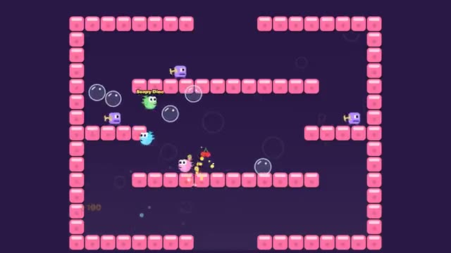

# Bubble Buddies

Blow bubbles, trap the critters, pop them into fruit. A multiplayer starter game from [Multiplayer Agent](https://multiplayeragent.com): 2D, co-op, 1–4 players, with a bot buddy when you play alone.

## How it plays

Blow a bubble at a critter to trap it, then jump into the bubble to pop it into fruit. Hold jump to bounce on bubbles and ride them up. Clear every critter to reach the next level; the team shares its lives.

**Controls:** Arrows or A/D to move, Z or Space to jump (hold to ride bubbles), X to blow; on touch, the on-screen buttons.

## Make it yours in the Game Builder

Open the [Game Builder](https://multiplayeragent.com), choose **Start from a starter game** and pick Bubble Buddies. It opens as version 1 in your studio, ready to play and publish. Then ask for changes, for example:

- Add a boss level every fifth level
- Make the bubbles shoot farther the longer I hold the button
- Add a power-up shoe that makes me run faster

## Run it yourself

1. Get a free publishable key (`pk_…`) at [multiplayeragent.com](https://multiplayeragent.com).
2. In `index.html`, put it in place of `pk_REPLACE_ME` in the `MP_CONNECT` block.
3. Open `index.html` in a browser. No build step and no server needed.

Without a key it still runs, offline with a bot buddy.

## How it is built

- One `index.html`. The comment at the top of the script maps the code and explains the multiplayer.
- **Leaderboard:** The team's score, shown when the last life is gone.
- **Bots:** A bot buddy joins you when you play alone.
- **Host-run rules:** The host's browser runs the critters, bubbles and fruit; if it leaves, the next player takes over.
- **Live sync:** Everyone runs and jumps in the same level at once.
- `?attract` runs it offline with bots only. The preview video is recorded from it.

## License

MIT.
